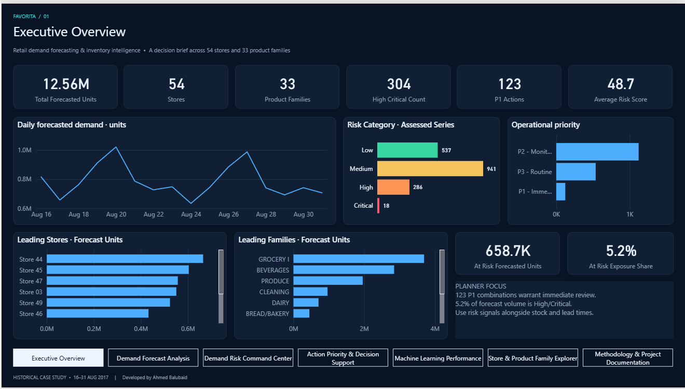
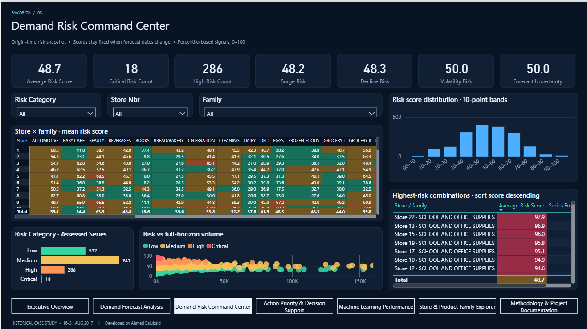
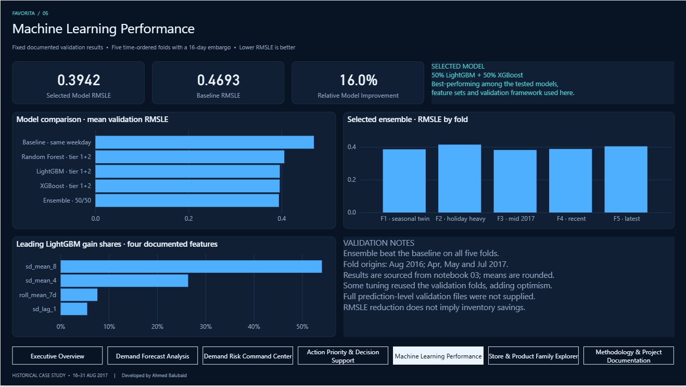

# Retail Demand Forecasting & Inventory Intelligence

**End-to-end retail analytics case study:** leakage-safe time-series feature engineering, machine-learning demand forecasting, explainable demand-risk scoring, SQL analytics, and a validated Power BI decision-support dashboard.

**Dataset:** Corporación Favorita historical store sales  
**Forecast horizon:** 16–31 August 2017  
**Scope:** 54 stores × 33 product families = 1,782 store-family series



## Business objective

Estimate short-term unit demand by store and product family, then convert forecasts into transparent review priorities for planners. The project is deliberately framed as **demand-based inventory attention**, not stockout/overstock prediction: the source data does not include inventory on hand, reorder points, lead times, safety stock, purchase orders, or supplier constraints.

## End-to-end workflow

`Historical sales → EDA → Leakage-safe feature engineering → ML forecasting → Demand-risk engine → SQL analytics → Power BI decision support`

## Key results

| Metric | Result |
|---|---:|
| Forecast rows | 28,512 |
| Total forecasted units | 12,563,212.295 |
| Baseline RMSLE | 0.4693 |
| Selected ensemble RMSLE | **0.3942** |
| Improvement vs baseline | **16.0% lower RMSLE** |
| Store × family series assessed | 1,782 |
| High + Critical series | 304 |
| P1 Immediate Review | 123 |
| Average demand risk score | 48.657 |
| High/Critical forecast exposure | 658,722.289 units (≈5.24%) |

The selected forecasting strategy was a **50/50 LightGBM + XGBoost ensemble**, chosen from the models and feature sets tested under five embargoed, time-ordered validation folds. It beat the same-weekday baseline on all five folds.

## Modeling approach

### 1. Exploratory data analysis
The EDA focuses on business-relevant data quality and time-series behavior: structural zeros, store openings/closures, missing Christmas dates, promotion regime changes, seasonality, holidays, and intermittent demand.

### 2. Leakage-safe feature engineering
The modeling design uses forecast-origin features, lag/rolling statistics, same-weekday history, promotions, calendar/holiday features, trend and volatility indicators. Validation mimics the real 16-day forecast with five time-ordered folds and a 16-day embargo.

Dormant and never-sold series use an explicit zero rule; live intermittent zero-demand days remain part of the modeled problem.

### 3. Machine-learning forecasting
Models compared:
- Same-weekday baseline — 0.4693 RMSLE
- Random Forest — 0.4058
- LightGBM — 0.3961
- XGBoost — 0.3959
- **50/50 LightGBM + XGBoost — 0.3942 (selected)**

### 4. Demand-risk engine
Each of the 1,782 store-family series is scored on four interpretable dimensions:
- Demand Surge Risk
- Demand Decline Risk
- Demand Volatility Risk
- Forecast Uncertainty

These feed a transparent 0–100 Demand Risk Score and action priority. The final distribution is 537 Low, 941 Medium, 286 High, and 18 Critical; 123 series are P1 Immediate Review.

### 5. SQL + Power BI
The SQL Server layer provides DDL, bulk-load scripts, five analytical views, nine business queries, and reconciled star-schema exports. The final Power BI implementation extends the earlier design into **11 semantic-model tables, 7 active single-direction relationships, 41 DAX measures, 7 business pages, and 1 hidden tooltip page**.

## Dashboard

### Demand Risk Command Center


### Machine Learning Performance


The remaining pages are available in [`screenshots/`](screenshots/): Demand Forecast Analysis, Action Priority & Decision Support, Store & Product Family Explorer, and Methodology & Project Documentation.

## Repository structure

```text
notebooks/         EDA, feature engineering, forecasting, risk engine
src/               Shared analysis utilities available in the release
data_samples/      Compact feature metadata and modeling-table sample
outputs/           Final forecast and risk-engine outputs
sql/               SQL Server scripts + compact star-schema tables
powerbi/           Final PBIX + editable PBIP/PBIR semantic-model source
screenshots/       Seven final dashboard pages
docs/              Project notes, SQL design lineage, reproducibility
validation/        Final reconciliation and Power BI validation evidence
```

## Power BI release

Open:

`powerbi/Retail_Demand_Forecasting_Inventory_Intelligence_Polished.pbix`

The validated PBIX opens on **Executive Overview** and contains imported data. For editable source control, use the `.pbip` project and `Configure_Data_Path.ps1` when the folder location changes.

Final validation recorded:
- **152/152 static checks passed**
- **23/23 Desktop DAX assertions passed**
- Fresh launch verified on Executive Overview
- P1 + P2 saved as the default Action Priority view; P3 remains selectable
- 41 DAX expressions and seven relationships preserved

See [`validation/FINAL_POLISH_VALIDATION.md`](validation/FINAL_POLISH_VALIDATION.md).

## SQL validation

The SQL Server scripts were logically reconciled against the same star-schema CSVs through a DuckDB reference implementation. The original Phase 6 reconciliation recorded **26/26 checks passing**, including row counts, forecast totals, risk distributions, priorities, duplicate-key checks, and dormant-series handling.

## Limitations

- Historical case study; not live monitoring.
- Forecast horizon is 16–31 August 2017, with forecast origin 15 August 2017.
- Risk is a fixed origin-time snapshot; daily date filters apply to forecast facts, not risk snapshots.
- Promotion association is descriptive, not causal uplift.
- RMSLE improvement is not a financial-savings claim.
- Inventory levels, lead times, safety stock, supplier constraints, and purchasing costs are not available.
- Some validation folds were also used during tuning, so reported performance may contain optimism.

## Public-repository data policy

The full raw training dataset and heavy development artifacts are intentionally excluded from this GitHub-ready package. See [`docs/REPRODUCIBILITY.md`](docs/REPRODUCIBILITY.md) and [`data_samples/README.md`](data_samples/README.md).

---

Developed by **Ahmed Balubaid** as a historical retail analytics portfolio case study.
